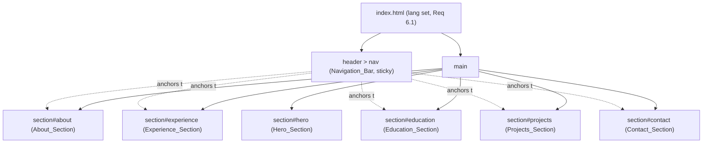

# Design Document

## Overview

The Portfolio_Site is a static, single-page website for Ulysses Galli, built with plain HTML, CSS, and JavaScript and no build step. It presents the Owner's professional trajectory, academic background, projects, and a personal summary within one scrollable page, organized into labeled sections and navigable through an in-page Navigation_Bar.

The design is driven by three constraints that shape every decision below:

1. **Static and buildless** (Req 2): the deliverable is a folder of files that renders when opened directly or served as static assets — no framework, no bundler, no server runtime.
2. **Content-first, JS-optional** (Req 2.4): all textual content lives directly in semantic HTML, so the page is fully readable with JavaScript disabled. JavaScript only enhances behavior (smooth scrolling, focus management).
3. **Ivy League identity** (Req 4): an academic, sober aesthetic expressed through serif headings and a navy / cream / gold palette defined as CSS custom properties.

The site is intended for deployment on static hosts such as GitHub Pages or Netlify (see Deployment).

## Architecture

### Rendering approach: semantic HTML, not JS-rendered data

Two approaches were considered for structuring the content:

- **(A) Semantic HTML authored directly** — each section, card, and entry is written as HTML markup.
- **(B) A JavaScript data object** (e.g. `const content = { experience: [...] }`) rendered into the DOM at load time.

**Decision: approach (A), semantic HTML authored directly.**

Rationale: Requirement 2.4 mandates that all textual content of every section be present when JavaScript is disabled. Approach (B) would hide content behind a script and violate 2.4 unless duplicated as a `<noscript>` fallback, which is more complex and error-prone than simply authoring the content once in HTML. Approach (A) is also the simplest to host, the fastest to render (text paints without waiting for script execution, supporting Req 7.1 and 7.3), and the easiest for the Owner to edit by hand. JavaScript is therefore reserved for progressive enhancement only.

The "data model" is consequently a set of repeatable HTML structures (documented in Data Models) rather than a runtime object graph.

### File structure

```
portfolio-website/
├── index.html        # The single page: all sections and content
├── styles.css        # All styling: palette tokens, typography, layout, responsive rules
├── main.js           # Progressive enhancement: smooth scroll + focus management
└── assets/           # Images (optional hero photo, favicon) and any static media
    └── (profile.jpg, favicon.svg, ...)
```

This flat structure satisfies Req 2.1 (only HTML/CSS/JS files) and Req 2.2/2.3 (renders as static assets with no build or server runtime).

### High-level page structure



Each section carries a unique `id` (Req 1.3), and the Navigation_Bar holds one Anchor_Link per content section (Req 3.1). The Hero_Section is intentionally excluded from the nav links (per Req 3.1, which lists About through Contact).

## Components and Interfaces

### Navigation_Bar

A `<header>` containing a `<nav aria-label="Primary">` with an unordered list of Anchor_Links.

- Each Anchor_Link is an `<a href="#section-id">` whose target matches an existing section `id` (Req 3.1).
- Each link carries a descriptive accessible name from its visible text or an `aria-label` (Req 6.6).
- The header is `position: sticky; top: 0` so it stays accessible while scrolling (Req 3.4). On Mobile_Layout it collapses to a compact bar; links wrap or scroll horizontally within the bar rather than causing page-level horizontal scroll (Req 5.3).

Interface (behavioral contract, enhanced by `main.js`):

```text
onAnchorActivate(href):
    target = document.querySelector(href)        # e.g. "#experience"
    scroll viewport to target (smooth)            # Req 3.2
    set target tabindex = -1 (if absent)
    target.focus()                                # Req 3.3 (keyboard focus moves)
```

Smooth scrolling is also provided declaratively via CSS `scroll-behavior: smooth` and `scroll-margin-top` on sections (to offset the sticky header), so basic scrolling (Req 3.2) works even with JavaScript disabled; `main.js` adds the focus move (Req 3.3), which anchors alone cannot guarantee across browsers.

### Hero_Section (`#hero`)

Contains, in reading order (text before media, Req 7.3):

- The Owner's name "Ulysses Galli" in an `<h1>` using the serif display face at strong weight (Req 1.5, 4.1).
- The headline "Sales at Amazon Web Services | 3x AWS Certified | UNIFESP | FGV" (Req 1.6).
- A list of Role_Chip elements: "Sales", "Strategy", "AI" (Req 1.7).
- A set of social link icons, including LinkedIn → `https://linkedin.com/in/ulyssesgalli` (Req 8.1). Icons are inline SVG (no external icon font, keeping the asset budget small). Each link has an accessible name.
- An optional profile photo (`` with descriptive `alt`, or empty `alt` if decorative — Req 6.3), placed after the text in source order and lazy-loaded (`loading="lazy"`) so text paints first (Req 7.3).

### About_Section (`#about`)

An `<h2>` heading plus a personal summary paragraph (Req 1.8). Heading is visible (Req 1.4).

### Experience_Section (`#experience`)

An `<h2>` heading followed by a list of Organization_Group cards (Req 1.9, 4.7). See Data Models for the group/role structure. Groups are authored in reverse chronological order by most recent Role_Entry period (Req 9.5).

### Education_Section (`#education`)

An `<h2>` heading followed by repeatable Education_Entry blocks (Req 1.10, 10.1).

### Projects_Section (`#projects`)

An `<h2>` heading followed by repeatable project cards, each with name, description, and link (Req 1.11, 4.7).

### Contact_Section (`#contact`)

An `<h2>` heading followed by a link-in-bio style list of labeled links (Req 8.2, 8.4).

### main.js (progressive enhancement)

Single, dependency-free script. Responsibilities, kept minimal:

- Focus management on Anchor_Link activation (Req 3.3).
- Optional active-link highlighting as sections enter the viewport (cosmetic; via `IntersectionObserver`).

The script must not be required for any text content to appear (Req 2.4) and must degrade gracefully if it fails to load.

## Data Models

Because the chosen approach is semantic HTML (see Architecture), the "data models" are repeatable markup contracts. Content is in Portuguese on the live site; identifiers and structure are shown here in English per the spec convention.

### Organization_Group / Role_Entry / Highlight_Badge

```html
<article class="card org-group">
  <h3 class="org-name">Amazon Web Services</h3>   <!-- organization heading, exactly once (Req 9.1, 9.3) -->
  <ol class="roles">
    <li class="role-entry">
      <h4 class="role-title">Sales Executive</h4>              <!-- Req 9.2 -->
      <p class="role-period"><time>2022</time> – <time>Present</time></p>
      <span class="highlight-badge">150% quota</span>          <!-- optional (Req 9.4, 9.7) -->
      <p class="role-description">…</p>
    </li>
    <li class="role-entry">
      <h4 class="role-title">Program Manager</h4>
      <p class="role-period"><time>2020</time> – <time>2022</time></p>
      <p class="role-description">…</p>
    </li>
  </ol>
</article>
```

Rules:
- Exactly one `.org-name` heading per group; all roles for the organization are nested under it (Req 9.1, 9.3).
- Each `.role-entry` carries a title, a period, and a description (Req 9.2).
- `.highlight-badge` is present only on roles with a notable achievement (Req 9.4), styled with the gold accent (Req 4.4).
- Required content: an AWS group with "Sales Executive" (badge "150% quota") and "Program Manager" (Req 9.6, 9.7); an EPPEN JR group with "Deliberative Counselor", "Project Management Director", and "Junior Consultant" (Req 9.8).

### Education_Entry

```html
<article class="edu-entry">
  <h3 class="edu-institution">UNIFESP</h3>              <!-- Req 10.1 -->
  <p class="edu-subtitle">Top 10 universidades brasileiras</p>  <!-- Req 10.2, 10.3 -->
  <p class="edu-qualification">…</p>
  <p class="edu-period"><time>…</time></p>
</article>
```

Required entries: UNIFESP (with the subtitle above), FGV, LMU München (Req 10.3, 10.4, 10.5).

### Project card

```html
<article class="card project">
  <h3 class="project-name">…</h3>
  <p class="project-description">…</p>
  <a class="project-link" href="…" target="_blank" rel="noopener noreferrer">…</a>
</article>
```

Each card carries name, description, and link (Req 1.11); links opening a new context use `rel="noopener noreferrer"` (Req 8.5).

### Contact link

```html
<a class="contact-link" href="…" target="_blank" rel="noopener noreferrer">
  <span class="contact-label">LinkedIn</span>   <!-- visible label, Req 8.4 -->
</a>
```

## Visual Identity and Styling

### Color palette (CSS custom properties)

Four principal colors maximum (Req 4.2). Navy is primary, cream is the primary background, gold is the accent (Req 4.3, 4.4); a dark ink is used for body text to guarantee contrast.

```css
:root {
  /* Principal palette — four colors (Req 4.2) */
  --color-primary: #1a2a4f;   /* navy  — headings, nav, primary text accents (Req 4.3) */
  --color-bg:      #f5f1e8;   /* cream — page background (Req 4.3) */
  --color-accent:  #b89b5e;   /* gold  — chip borders, highlight badges (Req 4.4) */
  --color-ink:     #22262b;   /* dark ink — body text for AA contrast on cream */

  /* Spacing scale (reused for consistent spacing/alignment, Req 4.5) */
  --space-1: 0.5rem; --space-2: 1rem; --space-3: 1.5rem;
  --space-4: 2rem;   --space-6: 3rem; --space-8: 4rem;

  /* Typography */
  --font-serif: "Playfair Display", Georgia, "Times New Roman", serif; /* headings + name (Req 4.1, 1.5) */
  --font-body:  Georgia, "Iowan Old Style", "Times New Roman", serif;   /* readable serif body */
  --font-size-body: 1rem; /* 16px baseline (Req 5.4) */
}
```

Contrast note (Req 6.4): body text uses `--color-ink` (#22262b) on `--color-bg` cream (#f5f1e8), a ratio well above 4.5:1. Navy (#1a2a4f) on the same cream also exceeds 4.5:1 and is safe for headings and primary text. The gold accent is used for borders and badge fills, not for small body text, so it is not required to meet the 4.5:1 body-text threshold.

### Typography

- Headings and the Hero name use `--font-serif` (Req 4.1, 1.5). The display face (Playfair Display) is loaded from Google Fonts with `preconnect` and `font-display: swap` so text renders immediately in the fallback serif while the webfont loads (Req 7.1, 7.3).
- Body text uses a system serif stack by default, so no webfont is required for reading (keeps within the performance budget and avoids layout shift).
- Base body font size is 16px and never drops below 16px on Mobile_Layout (Req 5.4).

```html
<link rel="preconnect" href="https://fonts.googleapis.com">
<link rel="preconnect" href="https://fonts.gstatic.com" crossorigin>
<link href="https://fonts.googleapis.com/css2?family=Playfair+Display:wght@600;700&display=swap" rel="stylesheet">
```

### Layout and cards

- Mobile-first CSS: base styles target Mobile_Layout; a single `@media (min-width: 768px)` block introduces Desktop_Layout (Req 5.1, 5.2).
- Organization_Groups and project entries are `.card` blocks: cream surface, subtle border, generous padding, consistent spacing from the shared spacing scale (Req 4.7, 4.5).
- Role_Chips are inline pills with a gold border (Req 4.4). Highlight_Badges are small gold-filled labels (Req 4.4).
- Layout avoids fixed widths that exceed the viewport; images are `max-width: 100%` to prevent horizontal overflow on mobile (Req 5.3).
- Minimalist: no decorative elements unrelated to content (Req 4.6).

### Responsiveness

- `html { overflow-x: hidden }` is avoided as a crutch; instead layout uses fluid widths, `max-width: 100%` media, and wrapping flex/grid so that `document.scrollWidth` never exceeds the viewport on mobile widths (Req 5.3).
- Sections set `scroll-margin-top` equal to the sticky header height so anchored navigation lands below the header (Req 3.2).

### Focus and keyboard

- A global `:focus-visible` style draws a visible outline (e.g. a 2px gold/navy outline) on every focusable element (Req 6.5).
- Sections targeted by navigation receive `tabindex="-1"` dynamically (or via markup) so they can receive programmatic focus (Req 3.3) without entering the tab order.

## Accessibility

- `<html lang="pt-BR">` sets the document language (Req 6.1).
- One `<h1>` (Hero name), `<h2>` per section heading, `<h3>`/`<h4>` for cards and roles, with no skipped levels (Req 6.2).
- Every non-decorative `` has a descriptive `alt`; purely decorative images use `alt=""` (Req 6.3).
- Body/background contrast ≥ 4.5:1 (Req 6.4), verified from the palette tokens.
- Visible focus indicator on all focusable elements (Req 6.5).
- Navigation anchors expose descriptive accessible names (Req 6.6).

## Performance

- Total CSS + JS transferred size budget: ≤ 150 KB combined, excluding images and fonts (Req 7.2). A single small stylesheet and a single small script easily fit; inline SVG icons avoid an icon-font download.
- Fonts loaded with `preconnect` + `display=swap`; body remains readable in the fallback serif immediately (Req 7.1, 7.3).
- Text content is authored directly in HTML and placed before non-essential media in source order; images use `loading="lazy"` so section text displays before media finishes loading (Req 7.3).
- No render-blocking JavaScript: `main.js` is loaded with `defer`.

## Error Handling

As a static content site with no server runtime and no user input processing, runtime error surface is minimal. The relevant failure modes and responses:

- **JavaScript fails to load or is disabled**: all section text and links remain present and usable; anchor links still scroll via CSS `scroll-behavior` (Req 2.4, graceful degradation). Only the focus-move enhancement (Req 3.3) is lost.
- **Webfont fails to load**: `font-display: swap` leaves text rendered in the fallback serif stack; no blank text (Req 7.1).
- **Image fails to load or is missing**: the `alt` text conveys the content (Req 6.3); layout does not collapse because images are constrained with `max-width: 100%` and the surrounding text is independent of the image.
- **Anchor target missing**: authoring contract requires every nav `href` to match an existing section `id` (Req 3.1); the property tests below guard against drift so a broken anchor is caught before deployment rather than failing silently at runtime.

## Deployment

The site is deployed as static files. Two low-friction options:

- **GitHub Pages**: push `index.html`, `styles.css`, `main.js`, and `assets/` to a repository and enable Pages on the chosen branch; the root serves `index.html` directly.
- **Netlify**: connect the repository (or drag-and-drop the folder); no build command and the publish directory is the project root.

Both require no build step, consistent with Req 2.2 and 2.3.

## Correctness Properties

*A property is a characteristic or behavior that should hold true across all valid executions of a system — essentially, a formal statement about what the system should do. Properties serve as the bridge between human-readable specifications and machine-verifiable correctness guarantees.*

These properties are pragmatic structural and styling invariants over the rendered page, verifiable by parsing `index.html` and the computed styles. Because this is a static site, properties focus on structural integrity (anchors, headings, cards), ordering (experience chronology), and policy constraints (palette size, contrast, safe link relationships) rather than on input-varying business logic.

### Property 1: Section identifiers are present and unique

*For all* required sections (Hero, About, Experience, Education, Projects, Contact), each section element has a non-empty `id`, and no two sections share the same `id`.

**Validates: Requirements 1.3**

### Property 2: Every non-hero section has a visible heading

*For any* section other than the Hero_Section, that section contains at least one heading element with non-empty visible text.

**Validates: Requirements 1.4**

### Property 3: Navigation links correspond one-to-one with content sections

*For every* Anchor_Link in the Navigation_Bar, its `href` fragment resolves to an existing section `id`; and *for each* of the About, Experience, Education, Projects, and Contact sections, exactly one Anchor_Link targets it.

**Validates: Requirements 3.1**

### Property 4: All section text is present without JavaScript

*For every* section, its textual content is present in the served HTML with scripting disabled.

**Validates: Requirements 2.4**

### Property 5: Navigation anchors have descriptive accessible names

*For every* Anchor_Link in the Navigation_Bar, its accessible name (visible text or `aria-label`) is non-empty.

**Validates: Requirements 6.6**

### Property 6: Heading hierarchy does not skip levels

*For all* headings taken in document order, each heading's level is at most one greater than the maximum heading level seen before it, so no level is skipped.

**Validates: Requirements 6.2**

### Property 7: Every non-decorative image has a text alternative

*For every* `` element, an `alt` attribute is present, and it is non-empty unless the image is explicitly marked decorative (`alt=""` with a decorative role).

**Validates: Requirements 6.3**

### Property 8: Body text meets the contrast threshold

*For any* defined body-text / background color pair in the palette tokens, the WCAG contrast ratio is at least 4.5:1.

**Validates: Requirements 6.4**

### Property 9: Principal palette is limited to four colors

*For all* principal palette custom properties defined in `:root`, the count of distinct principal colors is at most four.

**Validates: Requirements 4.2**

### Property 10: Organization groups and project entries are card-bounded

*For every* Organization_Group and *every* project entry, the element is wrapped in the bounded card component.

**Validates: Requirements 4.7**

### Property 11: Each organization group has exactly one organization heading

*For every* Organization_Group, there is exactly one organization heading, and all of the group's Role_Entries are nested under that single heading.

**Validates: Requirements 9.1, 9.3**

### Property 12: Every role entry is complete

*For every* Role_Entry, a role title, a time period, and a description are all present.

**Validates: Requirements 9.2**

### Property 13: Experience groups are in reverse chronological order

*For all* consecutive pairs of Organization_Groups in document order, the most recent Role_Entry period of the earlier group is greater than or equal to that of the later group (groups are sorted descending by most recent role period).

**Validates: Requirements 9.5**

### Property 14: Every project card is complete

*For every* project card, a project name, a description, and a link are all present.

**Validates: Requirements 1.11**

### Property 15: Every education entry is complete

*For every* Education_Entry, an institution name, a qualification, a time period, and a descriptive subtitle are all present.

**Validates: Requirements 10.1, 10.2**

### Property 16: Links opening a new context use a safe relationship

*For every* anchor with `target="_blank"`, its `rel` attribute includes `noopener`.

**Validates: Requirements 8.5**

### Property 17: Every contact link has a visible label

*For every* link in the Contact_Section, a visible non-empty label identifying the destination is present.

**Validates: Requirements 8.4**

### Property 18: No horizontal scrolling on mobile widths

*For any* mobile viewport width in the range 320px to 767px, the document's scroll width does not exceed its client width.

**Validates: Requirements 5.3**

## Testing Strategy

A dual approach complements property tests with example and integration tests. Tests run in a headless DOM/browser environment (e.g. a DOM parser or a headless browser) against `index.html` and its computed styles; no build step is required to serve the files.

### Property tests

Properties 1–18 above are implemented as automated tests, each tagged **Feature: portfolio-website, Property {number}: {property text}** and referencing its design property. Where a property quantifies over a finite authored set (sections, cards, nav links), the "for all" is checked by iterating the full collection; where it quantifies over a continuous input (Property 18, viewport width), the test samples a minimum of 100 widths across the 320–767px range. Each property test runs a minimum of 100 iterations when inputs are generated.

### Example and edge-case tests

- Hero contains the exact name (Req 1.5), headline (Req 1.6), role chips Sales/Strategy/AI (Req 1.7), and a LinkedIn link to `linkedin.com/in/ulyssesgalli` (Req 8.1).
- AWS group contains "Sales Executive" and "Program Manager" with a "150% quota" badge on the Sales Executive (Req 9.6, 9.7); EPPEN JR group contains the three specified roles (Req 9.8).
- Education contains UNIFESP (with subtitle), FGV, and LMU München (Req 10.3–10.5).
- Palette tokens: `--color-primary` is navy, `--color-bg` is cream (Req 4.3); chip border and badge use the gold accent (Req 4.4).
- `html[lang]` is set (Req 6.1); `:focus-visible` styles are defined (Req 6.5).
- Breakpoint edge cases at 767px (Mobile_Layout) and 768px (Desktop_Layout) (Req 5.1, 5.2); computed body font-size ≥ 16px on mobile (Req 5.4).
- Anchor activation moves `location.hash` and sets focus to the target section (Req 3.2, 3.3).

### Integration / measurement checks

- Combined transferred CSS + JS size ≤ 150 KB (Req 7.2) — asset-size check over the served files.
- Hero render timing and text-before-media behavior (Req 7.1, 7.3) — a performance measurement run (e.g. Lighthouse), 1–2 runs, not property-based.
- Static-hosting smoke check: `index.html` opened directly renders all sections with no server and no build (Req 2.2, 2.3).
